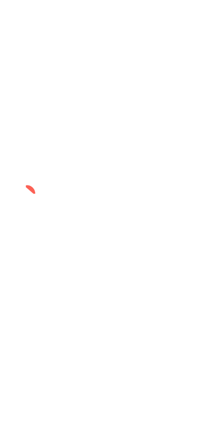

# Temporary Bites2B wordmark previews

**Four versions to compare:**

- **Variant B, approved:** [white stage, v2](white-v2/README.md), with the logo proportions of the official PNG.
- **Variant C:** [equal 2 and B, larger slogan](variant-c/README.md). [Mobile GIF](variant-c/mobile-390.gif), [desktop GIF](variant-c/desktop.gif).
- **Variant D:** [refined balanced wordmark](variant-d/README.md). [Mobile GIF](variant-d/mobile-390.gif), [desktop GIF](variant-d/desktop.gif).
- **Variant D2, final:** [5.9% narrower blue glyphs, 6.9-unit gap](variant-d2/README.md). [Mobile GIF](variant-d2/mobile-390.gif), [desktop GIF](variant-d2/desktop.gif), [English desktop](variant-d2/desktop-en.gif).

Variant B links:

| Preview | Direct link |
|---|---|
| Mobile (390 × 844) | [white-v2/mobile-390.gif](white-v2/mobile-390.gif) |
| Desktop (1280 × 720) | [white-v2/desktop.gif](white-v2/desktop.gif) |
| Small phone (320 × 640, English) | [white-v2/mobile-320-en.gif](white-v2/mobile-320-en.gif) |
| Slow-motion collision | [white-v2/collision-slow-motion.gif](white-v2/collision-slow-motion.gif) |

Preview assets are published here for review. The final code change is in the [draft PR](https://github.com/savinska/catering-saas/pull/35).
