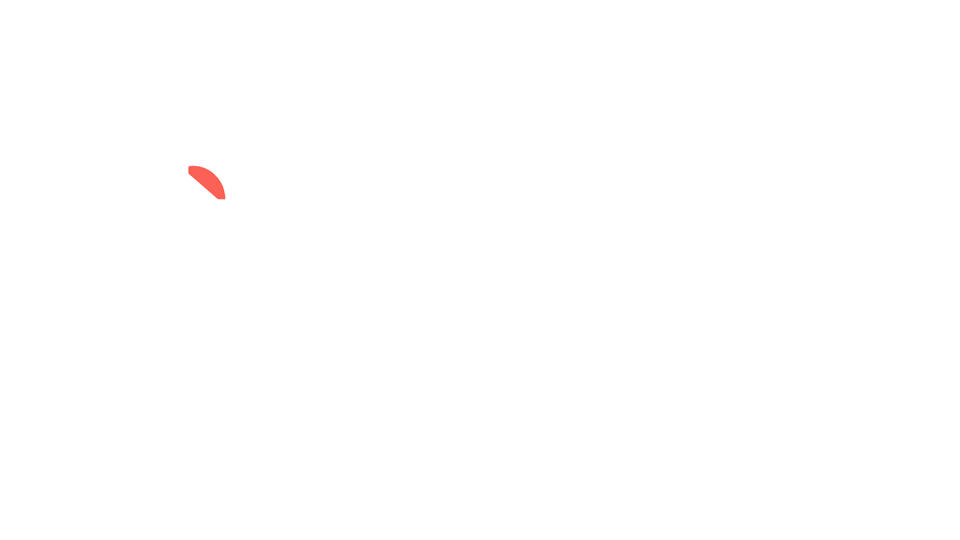
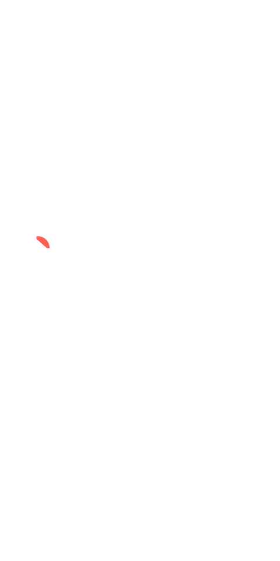
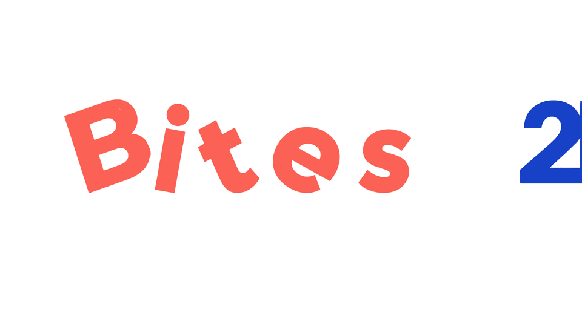
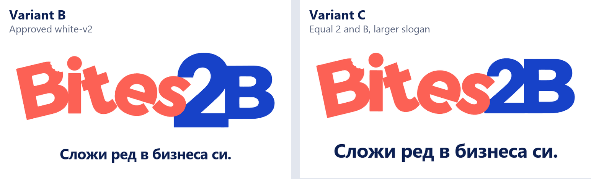
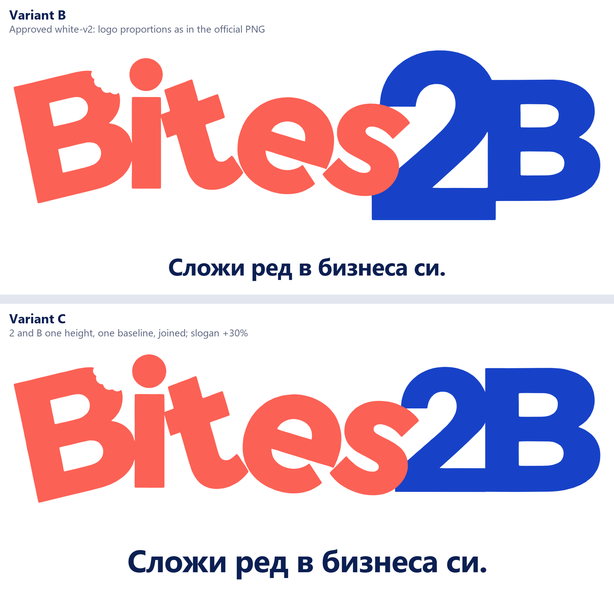
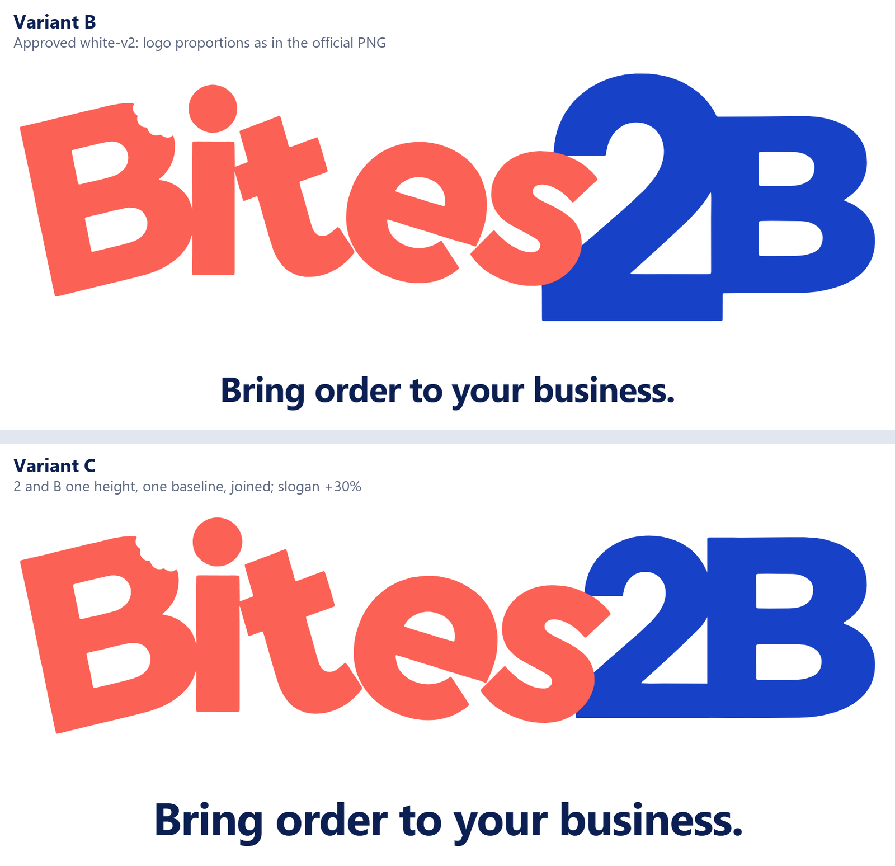

# Variant C: equal 2 and B, larger slogan

For comparison with the approved white-background version, variant B (in `../white-v2/`, unchanged).

**Changes from variant B:** the blue 2 is scaled to exactly the B's height, and both sit on one
baseline level with the orange letters. The 2 and B are joined with no gap, and the slogan is 30%
larger. Everything else is the same: white background, original coral and blue, the bite, the
stronger impact and chain reaction, the 4.3 s timing, and reduced-motion support.

## Animation (full sequence, then a 1.6 s hold, looping)

**Mobile, 390 px**

**Desktop, 1280 px**

**Small phone, 320 px, English**

**Impact and chain reaction, 0.3× speed**

## Final frame: variant B vs variant C

## Direct links

- Mobile GIF: https://raw.githubusercontent.com/savinska/bites2b-wordmark-previews-temp/main/variant-c/mobile-390.gif
- Desktop GIF: https://raw.githubusercontent.com/savinska/bites2b-wordmark-previews-temp/main/variant-c/desktop.gif
- 320 px English GIF: https://raw.githubusercontent.com/savinska/bites2b-wordmark-previews-temp/main/variant-c/mobile-320-en.gif
- Slow motion GIF: https://raw.githubusercontent.com/savinska/bites2b-wordmark-previews-temp/main/variant-c/collision-slow-motion.gif
- B vs C, mobile: https://raw.githubusercontent.com/savinska/bites2b-wordmark-previews-temp/main/variant-c/compare-b-vs-c-mobile.png
- B vs C, desktop: https://raw.githubusercontent.com/savinska/bites2b-wordmark-previews-temp/main/variant-c/compare-b-vs-c-desktop.png
