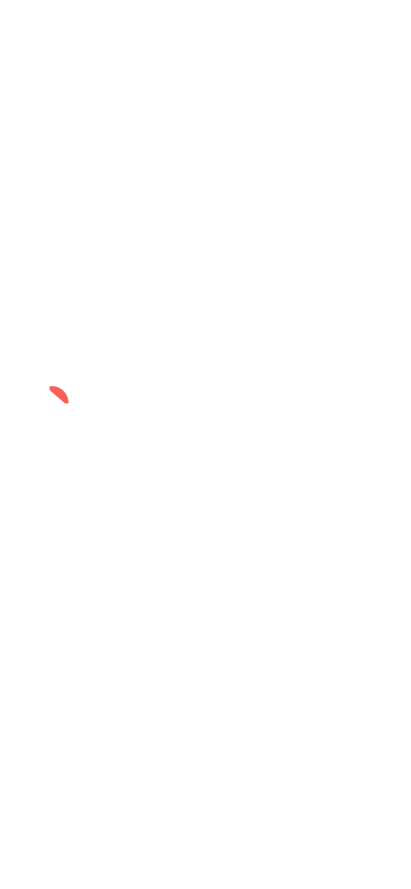
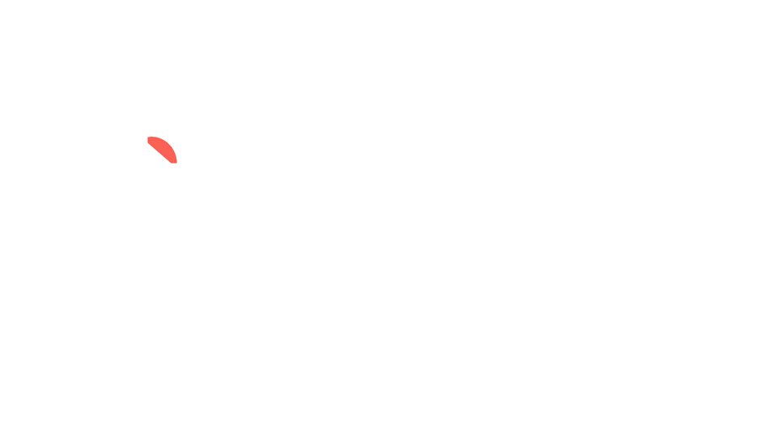
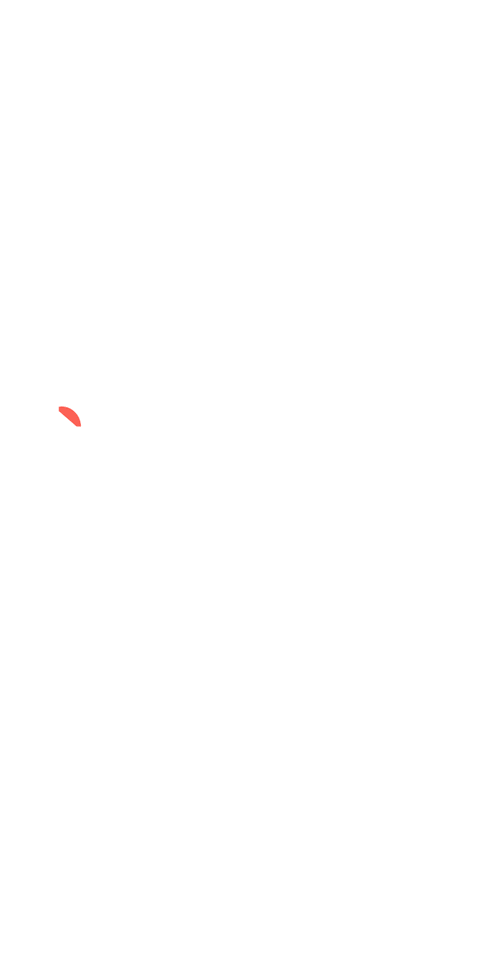
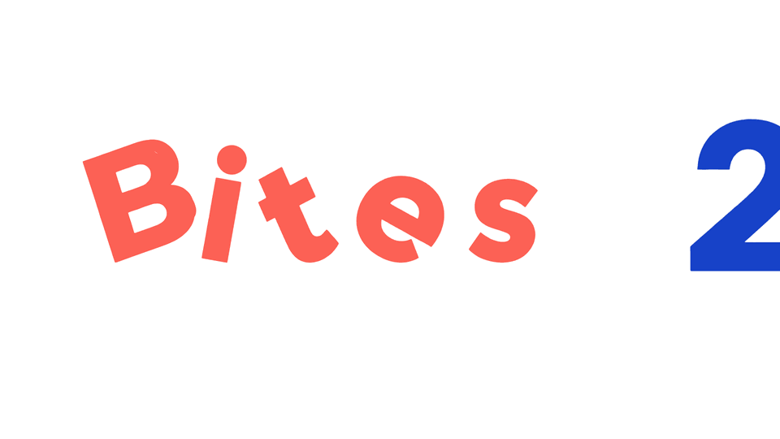
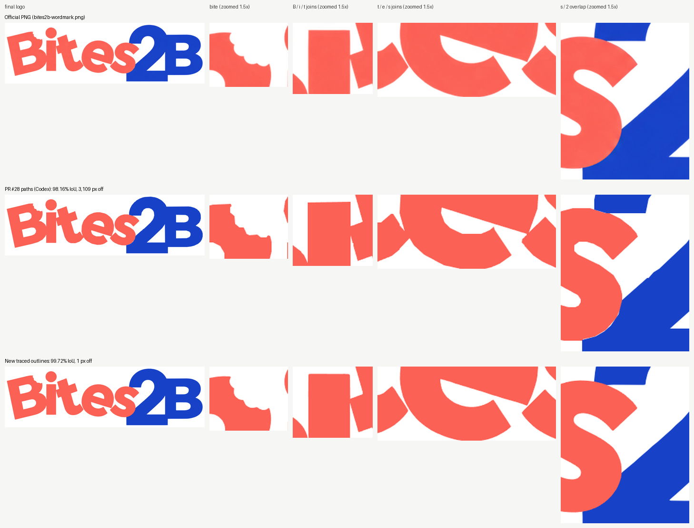

# Bites2B wordmark intro: white stage, v2 (for approval)

The full 4.3-second intro, then a 1.6-second hold on the finished logo. It loops.

1. The orange letters fall and land scattered.
2. The blue 2B slides in and hits the s.
3. The chain reaction pushes each letter into place.
4. The letters settle into the exact logo.
5. The bite is taken from the B.
6. The slogan appears.

The background is pure white `#ffffff`, and the logo uses the original coral `#fc6155` and blue
`#1742c8`.

## Mobile (390 × 844 phone, Bulgarian slogan)

## Desktop (1280 × 720, Bulgarian slogan)

## Small phone (320 × 640, English slogan)

## Impact and chain reaction at 0.3× speed

## Logo fidelity

Each letter is traced from the official PNG. The final frame matches it at 99.72%, with 1 pixel
visibly off; the earlier PR #28 version scores 98.16%, with 3,109 pixels off.

These are review previews only. Nothing is integrated, merged or deployed.
